# 🚀 HIRELOOP — Job Discovery & Hiring Platform

<div align="center">


[](https://www.oracle.com/java/)
[](https://spring.io/projects/spring-boot)
[](https://react.dev/)
[](https://tailwindcss.com/)
[](https://www.mysql.com/)
[](https://vitejs.dev/)

**A full-stack job portal web application built with Spring Boot 3, React.js (Vite), and MySQL, running locally on localhost.**  
*Featuring a sleek glassmorphic dark UI, strict role-based access control (RBAC), multi-currency compensation support (₹ INR & $ USD), PDF resume management, and dedicated workflows for Candidates, Employers, and Administrators.*

</div>

---

## 📌 Table of Contents
1. [Overview & Visual Design](#-overview--visual-design)
2. [Application Screenshots Gallery](#-application-screenshots-gallery)
3. [Role-Based Feature Highlights](#-role-based-feature-highlights)
4. [Tech Stack & Architecture](#-tech-stack--architecture)
5. [Database Schema & ERD](#-database-schema--erd)
6. [API Endpoints Reference](#-api-endpoints-reference)
7. [Running the Application Locally](#-running-the-application-locally)
8. [Demo Credentials & Seed Data](#-demo-credentials--seed-data)
9. [License](#-license)

---

## 🎨 Overview & Visual Design

**HIRELOOP** provides a unified hiring platform designed to run locally:
- **Pure Dark Glassmorphic Theme**: Deep navy backgrounds (`#0b0f19`) accented with luminous violet and teal gradients, backdrop blurs (`backdrop-blur-xl`), and subtle neon borders (`border-white/10`).
- **Interactive Password Visibility**: One-click password reveal/conceal toggle buttons with eye icons across all login and registration forms.
- **Accidental Logout Prevention**: Confirmation modal on logout ensuring users never get logged out by an unintended click.
- **Cascade Deletion Reliability**: Safe job deletion workflow with automatic child cleanup (applications & bookmarks) and active applicant warnings, preventing database foreign key constraint conflicts.
- **Fluid Micro-Animations**: Smooth page transitions powered by **Framer Motion**, animated counters (**CountUp**), hover lift cards, and skeleton shimmer loaders.
- **Localized Compensation**: Fast location filter chips (Bangalore, Hyderabad, Pune, Gurgaon, Remote) and currency rendering (₹ LPA for Indian openings, $k for US openings).
- **Responsive Engineering**: Fully optimized for mobile, tablet, and desktop viewports.

---

## 📸 Application Screenshots Gallery

### 🌐 1. Public & Discovery Experience
| Landing Page Hero & Categories | Find Jobs Search & Filters |
| :---: | :---: |
| 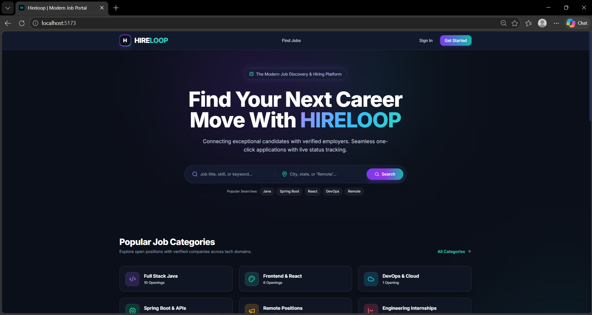 | 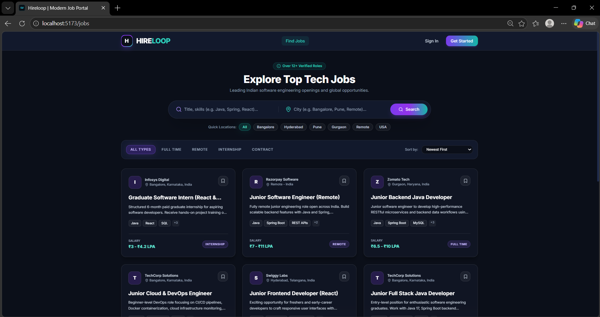 |
| *Modern glassmorphic landing page with live dynamic job opening counts and quick search* | *Real-time keyword search, location pills, and beginner-level openings* |

| Detailed Job View & Easy Apply |
| :---: |
| 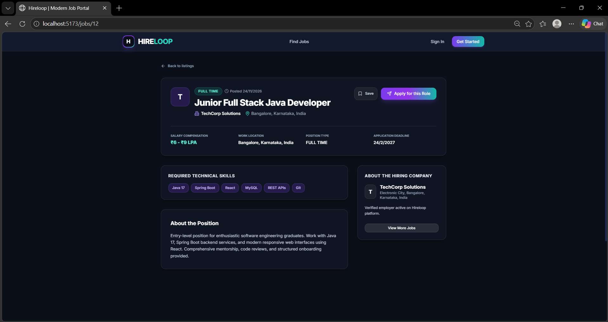 |
| *Job requirements, localized salary ranges (₹ LPA / $k), skills tags, and 1-click application* |

---

### 🎓 2. Candidate Portal (`jane@example.com` / `password123`)
| Candidate Profile & Resume Hub | My Applications Real-Time Tracker |
| :---: | :---: |
| 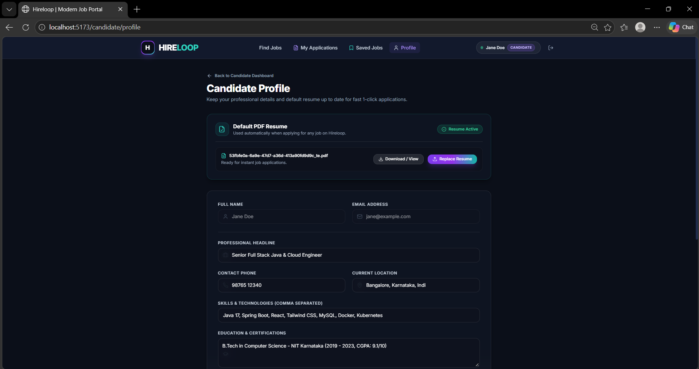 | 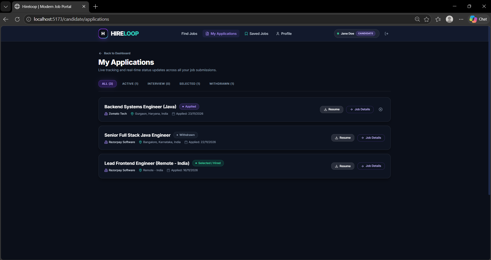 |
| *Headline, skills tags, education, experience, and uploaded PDF resume management* | *Real-time application tracking with status badges (Applied, Shortlisted, Interview, Selected)* |

---

### 🏢 3. Employer & Recruiter Portal (`alex@techcorp.com` / `password123`)
| Employer Analytics Dashboard | Manage Published Job Postings |
| :---: | :---: |
| 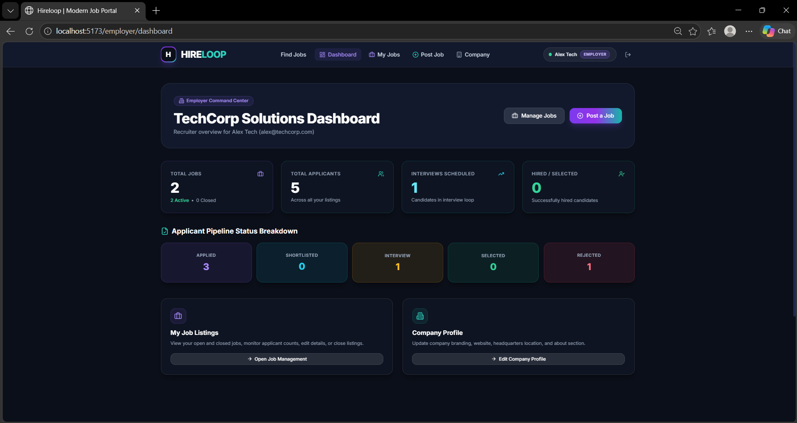 | 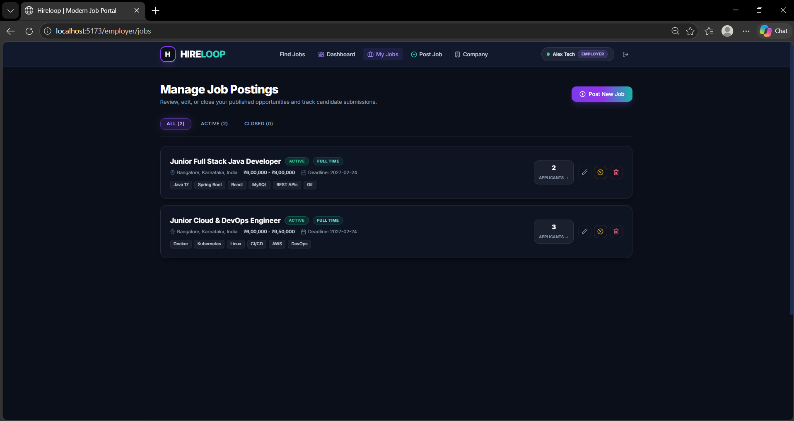 |
| *Recruiter KPI metrics and full 5-stage applicant pipeline conversion breakdown* | *Manage active/closed listings, track applicant counts, and safe cascade deletion* |

| Interactive Applicant Review Pipeline | Post New Job Opportunity |
| :---: | :---: |
| 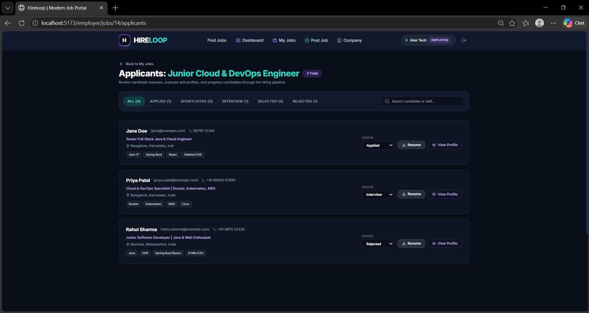 | 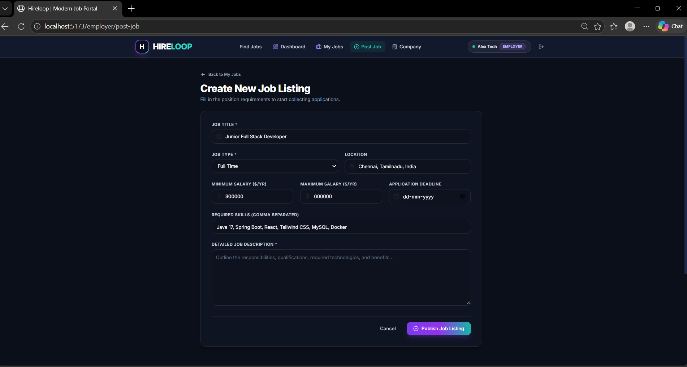 |
| *Candidate review with PDF resume download, full profile modal, and status stage dropdowns* | *Comprehensive job creation form with compensation ranges, skill tags, and deadlines* |

---

### 🛡️ 4. Administrator Control Center (`admin@hireloop.com` / `Admin@123`)
| Platform Command Center & Employer Verification Queue |
| :---: |
| 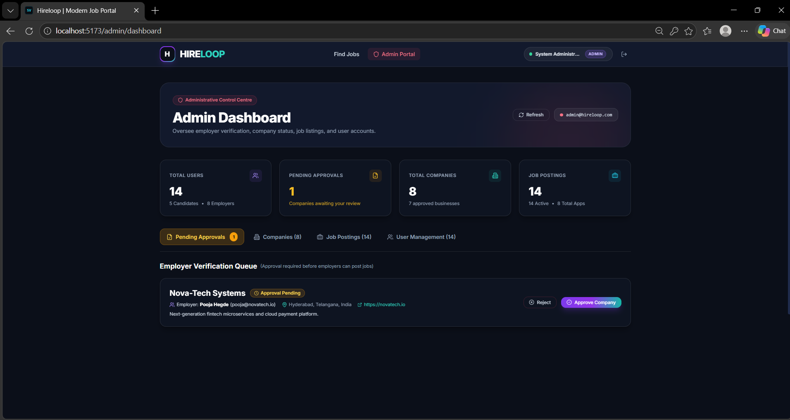 |
| *Platform-wide KPI metrics, pending company approval queue, verified company roster, and user controls* |

---

## 👥 Role-Based Feature Highlights

```
                                ┌───────────────────────────┐
                                │      HIRELOOP PORTAL      │
                                └─────────────┬─────────────┘
                ┌─────────────────────────────┼─────────────────────────────┐
                ▼                             ▼                             ▼
   ┌─────────────────────────┐   ┌─────────────────────────┐   ┌─────────────────────────┐
   │        CANDIDATE        │   │        EMPLOYER         │   │          ADMIN          │
   ├─────────────────────────┤   ├─────────────────────────┤   ├─────────────────────────┤
   │ • Fast JWT Registration │   │ • Company Registration  │   │ • Platform KPI Stats    │
   │ • Profile Builder       │   │ • Admin Approval Gate   │   │ • Employer Verification │
   │ • PDF Resume Upload     │   │ • Post/Edit/Close Jobs  │   │ • Company Moderation    │
   │ • Search & Filter Jobs  │   │ • Safe Cascade Deletion │   │ • Job Suspension / Rest │
   │ • Apply (Default/Custom)│   │ • Applicant Pipeline    │   │ • User Account Controls │
   │ • Track Applications    │   │ • PDF Resume Download   │   │ • Self-Suspension Block │
   │ • Bookmark / Save Jobs  │   │ • Status Updates (5 Stg)│   │ • Audit & Monitoring    │
   │ • Safe Logout Guard     │   │ • Analytics Dashboard   │   │ • Safe Logout Guard     │
   └─────────────────────────┘   └─────────────────────────┘   └─────────────────────────┘
```

### 1. 🎓 Candidate Features
- **Profile Hub**: Manage headline, phone, location, skills, education, and career experience.
- **Default Resume Management**: Upload and update a default `.pdf` resume stored securely in local file storage.
- **Job Discovery Engine**:
  - Full-text search across job titles, descriptions, and required skills.
  - Multi-parameter filters for location, job type (`FULL_TIME`, `PART_TIME`, `REMOTE`, `INTERNSHIP`, `CONTRACT`), and salary.
  - Quick-select IT hub filter chips (Bangalore, Hyderabad, Pune, Gurgaon, Remote).
- **Streamlined Application Workflow**:
  - Apply with default profile resume in 1-click or optionally upload a tailored `.pdf` resume for that specific job.
  - Duplicate application prevention (database unique constraint + API validation).
- **My Applications Tracker**: Real-time status badges (`APPLIED`, `SHORTLISTED`, `INTERVIEW`, `SELECTED`, `REJECTED`).
- **Saved Jobs**: One-click bookmarking to save jobs for future consideration.

### 2. 🏢 Employer Features
- **Company Verification Gate**: Employers register with company name, website, location, and description. Job posting is locked until verified by an Administrator (`PENDING` ➔ `APPROVED`).
- **Job Posting & Lifecycle Management**:
  - Create listings with compensation (₹ INR in Lakhs / $ USD in thousands), detailed descriptions, skills, deadlines, and job types.
  - Edit active listings or close completed hiring drives.
  - **Safe Permanent Deletion**: Delete postings with automatic cascade removal of associated applications and saved bookmarks, complete with confirmation warnings.
- **Interactive Applicant Pipeline**:
  - Review candidates who applied to each posting.
  - View full candidate profiles (education, skills, experience, contact).
  - Download uploaded PDF resumes via authenticated endpoints.
  - Move applicants across hiring stages: `APPLIED` ➔ `SHORTLISTED` ➔ `INTERVIEW` ➔ `SELECTED` / `REJECTED`.
- **Employer Analytics Dashboard**: High-level KPI cards for total jobs, active jobs, closed jobs, and applicant conversion counts per stage.

### 3. 🛡️ Administrator Features
- **Administrative Command Center**: Comprehensive metrics for total registered users, candidates, employers, companies, open postings, and applications.
- **Employer Verification Queue**: Review pending employer signups with 1-click **Approve** or **Reject** capabilities.
- **Company Status Controls**:
  - **Suspend Company**: Instantly hides all company postings from candidate searches and revokes employer login privileges (without destructive deletion).
  - **Reactivate Company**: Restores company access and unhides its job listings.
- **Job Moderation**: Suspend spam or non-compliant job listings.
- **User Management**: View all users across the platform, filter by role, and suspend/reactivate accounts (with built-in safeguard preventing administrators from suspending themselves).

---

## 💻 Tech Stack & Architecture

### Backend
| Technology | Version | Purpose |
| :--- | :--- | :--- |
| **Java** | 17+ (LTS) | Core object-oriented language runtime |
| **Spring Boot** | 3.3.5 | Backend REST API framework |
| **Spring Data JPA** | 3.3.5 | Object-Relational Mapping & query abstraction |
| **Hibernate** | 6.5.3.Final | JPA implementation and schema management |
| **Spring Security** | 6.3.4 | Authentication, Authorization & Security filter chain |
| **JJWT (Java JWT)** | 0.11.5 | Stateless JSON Web Token creation & parsing |
| **MySQL Connector/J**| 8.3.0 | Relational database driver |
| **Maven** | 3.9+ | Build and dependency lifecycle tool |

### Frontend
| Technology | Version | Purpose |
| :--- | :--- | :--- |
| **React** | 18.3.1 | Component-based declarative user interface |
| **Vite** | 5.4.10 | Fast frontend build tooling and local dev server |
| **React Router DOM** | 6.26.2 | Client-side routing with protected route guards |
| **Tailwind CSS** | 3.4.14 | Utility-first styling with custom dark glassmorphism |
| **Framer Motion** | 11.5.4 | Micro-interactions and page transitions |
| **Axios** | 1.7.7 | Promise-based HTTP client with JWT interceptors |
| **Lucide React** | 0.441.0 | Clean, lightweight SVG icon system |

### Layered Architecture
```
┌────────────────────────────────────────────────────────────────────────┐
│                        REACT FRONTEND (VITE)                           │
│  Pages • Components • AuthContext • Axios Interceptors • Tailwind CSS  │
└───────────────────────────────────┬────────────────────────────────────┘
                                    │ HTTP / JSON (Bearer JWT)
                                    ▼
┌────────────────────────────────────────────────────────────────────────┐
│                    SPRING BOOT REST CONTROLLERS                        │
│   AuthController • JobController • CandidateController                 │
│   EmployerController • AdminController • ApplicationController         │
└───────────────────────────────────┬────────────────────────────────────┘
                                    ▼
┌────────────────────────────────────────────────────────────────────────┐
│                 SPRING SECURITY & JWT FILTER CHAIN                     │
│   JwtAuthFilter • JwtUtils • DaoAuthenticationProvider • BCrypt        │
└───────────────────────────────────┬────────────────────────────────────┘
                                    ▼
┌────────────────────────────────────────────────────────────────────────┐
│                          SERVICE LAYER                                 │
│   AuthService • JobService • CandidateService • EmployerService        │
│   AdminService • ApplicationService • FileStorageService               │
└───────────────────────────────────┬────────────────────────────────────┘
                                    ▼
┌────────────────────────────────────────────────────────────────────────┐
│                   SPRING DATA JPA REPOSITORIES                         │
│   UserRepository • CompanyRepository • JobRepository                   │
│   CandidateProfileRepository • ApplicationRepository • SavedJobRepo    │
└───────────────────────────────────┬────────────────────────────────────┘
                                    ▼
┌────────────────────────────────────────────────────────────────────────┐
│                          LOCAL MYSQL DATABASE                          │
│   users • companies • jobs • candidate_profiles • applications         │
└────────────────────────────────────────────────────────────────────────┘
```

---

## 🗄️ Database Schema & ERD

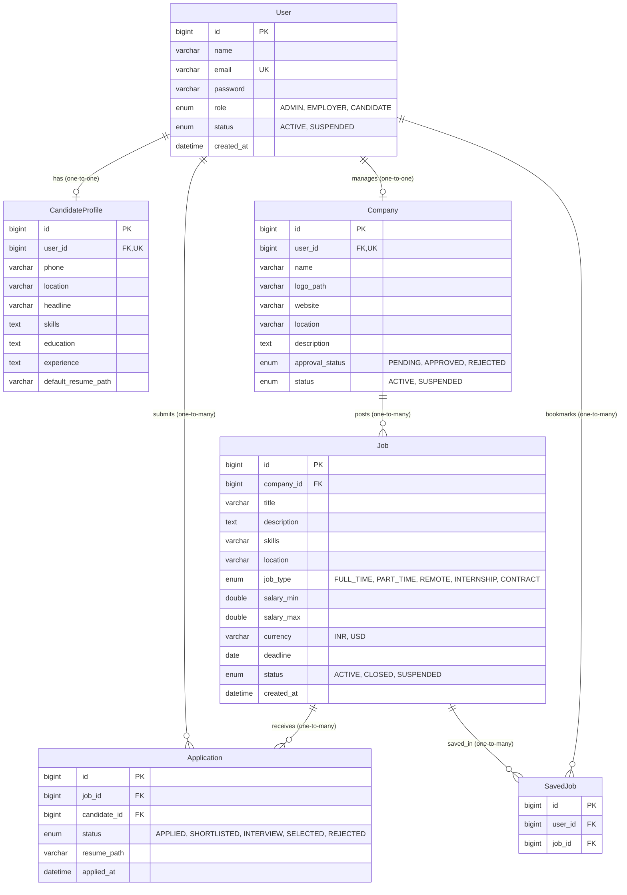

---

## 🌐 API Endpoints Reference

### 🔐 Authentication (`/api/auth`)
| Method | Endpoint | Access | Description |
| :--- | :--- | :--- | :--- |
| `POST` | `/api/auth/register/candidate` | Public | Register new candidate |
| `POST` | `/api/auth/register/employer` | Public | Register new employer with pending company |
| `POST` | `/api/auth/login` | Public | Authenticate user, check status, return JWT |

### 🔍 Jobs (`/api/jobs`)
| Method | Endpoint | Access | Description |
| :--- | :--- | :--- | :--- |
| `GET` | `/api/jobs` | Public | Search & filter jobs with pagination & sorting |
| `GET` | `/api/jobs/{id}` | Public | Get detailed job posting with company profile |

### 🎓 Candidate (`/api/candidate`)
| Method | Endpoint | Access | Description |
| :--- | :--- | :--- | :--- |
| `GET` | `/api/candidate/profile` | Candidate | Get authenticated candidate profile |
| `PUT` | `/api/candidate/profile` | Candidate | Update candidate profile details |
| `POST` | `/api/candidate/resume/upload` | Candidate | Upload and store default PDF resume |
| `POST` | `/api/candidate/applications` | Candidate | Apply for job (default or custom resume) |
| `GET` | `/api/candidate/applications` | Candidate | Get all applications with live status |
| `POST` | `/api/candidate/jobs/{jobId}/save` | Candidate | Bookmark or save a job |
| `DELETE`| `/api/candidate/jobs/{jobId}/unsave` | Candidate | Remove bookmark for a job |
| `GET` | `/api/candidate/saved-jobs` | Candidate | View all saved jobs |

### 🏢 Employer (`/api/employer`)
| Method | Endpoint | Access | Description |
| :--- | :--- | :--- | :--- |
| `GET` | `/api/employer/company` | Employer | Get employer company details |
| `PUT` | `/api/employer/company` | Employer | Update company profile information |
| `GET` | `/api/employer/stats` | Employer | Retrieve employer dashboard metrics |
| `GET` | `/api/employer/jobs` | Employer | Get all postings created by employer |
| `POST` | `/api/employer/jobs` | Employer (Approved) | Create new job posting |
| `PUT` | `/api/employer/jobs/{id}` | Employer (Approved) | Update existing job posting |
| `PATCH` | `/api/employer/jobs/{id}/close` | Employer | Mark job listing as closed |
| `DELETE`| `/api/employer/jobs/{id}` | Employer | Delete job posting (with cascade cleanup) |
| `GET` | `/api/employer/jobs/{id}/applicants` | Employer | View applicant list for specific job |
| `PATCH` | `/api/employer/applications/{id}/status`| Employer | Update applicant status in hiring pipeline |
| `GET` | `/api/employer/applications/{id}/resume`| Employer | Download candidate PDF resume |

### 🛡️ Administrator (`/api/admin`)
| Method | Endpoint | Access | Description |
| :--- | :--- | :--- | :--- |
| `GET` | `/api/admin/stats` | Admin | Overall platform statistics |
| `GET` | `/api/admin/companies/pending` | Admin | List companies awaiting approval |
| `GET` | `/api/admin/companies` | Admin | List all registered companies |
| `PATCH` | `/api/admin/companies/{id}/approve` | Admin | Approve pending company registration |
| `PATCH` | `/api/admin/companies/{id}/reject` | Admin | Reject company registration |
| `PATCH` | `/api/admin/companies/{id}/suspend` | Admin | Suspend company (hides jobs, blocks login) |
| `PATCH` | `/api/admin/companies/{id}/reactivate`| Admin | Reactivate suspended company |
| `GET` | `/api/admin/jobs` | Admin | List all job postings across platform |
| `PATCH` | `/api/admin/jobs/{id}/suspend` | Admin | Suspend individual job posting |
| `PATCH` | `/api/admin/jobs/{id}/reactivate` | Admin | Reactivate job posting |
| `GET` | `/api/admin/users` | Admin | List all registered users |
| `PATCH` | `/api/admin/users/{id}/suspend` | Admin | Suspend user account |
| `PATCH` | `/api/admin/users/{id}/reactivate` | Admin | Reactivate user account |

---

## 💻 Running the Application Locally

### 1. Prerequisites
- **Java Development Kit (JDK)**: 17 or higher
- **Node.js**: 18.x or 20.x
- **MySQL Server**: 8.0 or higher
- **Git**

---

### 2. Database Setup
1. Ensure your local MySQL service is running.
2. In your local MySQL client, create the database:
   ```sql
   CREATE DATABASE IF NOT EXISTS hireloop CHARACTER SET utf8mb4 COLLATE utf8mb4_unicode_ci;
   ```
3. Update `backend/src/main/resources/application.properties` with your local MySQL password if different:
   ```properties
   spring.datasource.url=jdbc:mysql://localhost:3306/hireloop?createDatabaseIfNotExist=true&useSSL=false&allowPublicKeyRetrieval=true&serverTimezone=UTC
   spring.datasource.username=root
   spring.datasource.password=root
   ```

---

### 3. Backend Setup (Spring Boot)
1. Open a terminal and navigate to the `backend` folder:
   ```bash
   cd backend
   ```
2. Run the application:
   ```bash
   mvn clean spring-boot:run
   ```
3. The backend starts at **`http://localhost:8080`**.
4. Health check endpoint: **`http://localhost:8080/api/health`** returns:
   ```json
   {
     "service": "Hireloop Job Portal API",
     "version": "1.0.0",
     "status": "UP"
   }
   ```
*(On first startup, `DataInitializer` automatically seeds the admin account, sample employers, jobs, candidate profiles, and sample applications into your local database).*

---

### 4. Frontend Setup (React + Vite)
1. In a second terminal, navigate to the `frontend` folder:
   ```bash
   cd frontend
   ```
2. Install dependencies:
   ```bash
   npm install
   ```
3. Start the local Vite development server:
   ```bash
   npm run dev
   ```
4. Open your browser and go to **`http://localhost:5173`**.

---

## 🔑 Demo Credentials & Seed Data

| Role | Email | Password | Details |
| :--- | :--- | :--- | :--- |
| **Admin** | `admin@hireloop.com` | `Admin@123` | System Administrator with full moderation control |
| **Employer (Approved)** | `alex@techcorp.com` | `password123` | Alex Vance — TechCorp India (Bangalore, 2 jobs, 5 applicants across all stages) |
| **Employer (Approved)** | `recruiter@razorpay.com`| `password123` | Harshil Mathur — Razorpay Software (Bangalore, 2 jobs) |
| **Employer (Approved)** | `careers@infosys.com` | `password123` | Salil Parekh — Infosys Digital (Bangalore, 2 jobs) |
| **Employer (Approved)** | `tech-hiring@zomato.com`| `password123` | Deepinder Goyal — Zomato Tech (Gurgaon, 2 jobs) |
| **Employer (Approved)** | `jobs@swiggy.in` | `password123` | Sriharsha Majety — Swiggy Labs (Hyderabad, 2 jobs) |
| **Employer (Approved)** | `jobs@stripe.com` | `password123` | Patrick Collison — Stripe Global (San Francisco, 2 jobs) |
| **Employer (Pending)** | `vikram@cloudnexus.in` | `password123` | Vikram Oberoi — CloudNexus Technologies (Pending Admin review) |
| **Candidate (Complete)** | `jane@example.com` | `password123` | Jane Doe — Full profile, resume, active applications |
| **Candidate (Entry-Level)** | `rahul.sharma@example.com`| `password123` | Rahul Sharma — Fresh graduate profile with active applications |
| **Candidate (DevOps)** | `priya.patel@example.com`| `password123` | Priya Patel — Cloud & DevOps engineer with interview applications |

---

## 📄 License

This project is licensed under the [MIT License](LICENSE).
